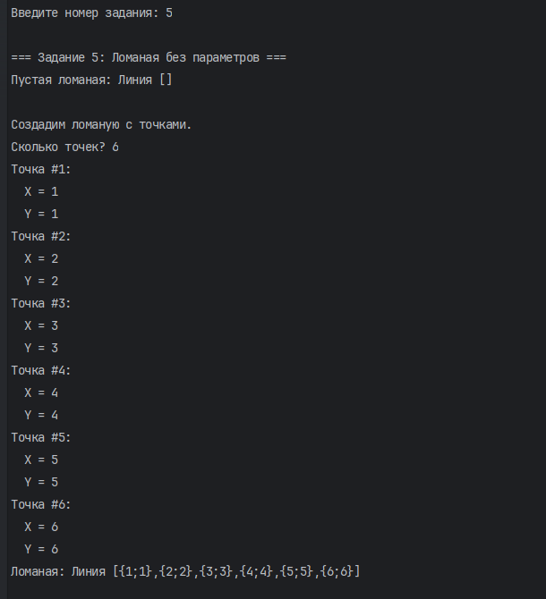
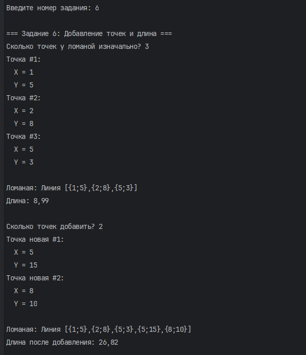

# Лабораторная работа № 2
## Объектно-ориентированное программирование на C#

**Выполнил:** Якунин Андрей  
**Группа:** ИТ-2  
**Вариант:** 10

## Цель работы

Изучить основы объектно-ориентированного программирования на языке C#, научиться создавать классы и объекты, использовать конструкторы, свойства и методы, а также реализовывать взаимодействие между объектами.

## Задание 1. Класс Name

### Условие

Реализовать класс `Name`, предназначенный для хранения имени человека. Класс должен поддерживать фамилию, имя и отчество, а также корректно обрабатывать отсутствие некоторых частей имени.

### Выполнение

Был создан класс `Name`, содержащий поля для фамилии, имени и отчества. Реализованы конструкторы для создания объектов с различным количеством частей имени, а также метод `ToString()` для получения строкового представления имени.

Программа запрашивает количество имён, после чего пользователь вводит данные для каждого человека. Имя является обязательным, фамилия и отчество могут отсутствовать.

### Результат выполнения

## Задание 2. Класс People с именем и ростом

### Условие

Создать класс `People`, содержащий имя человека и его рост.

### Выполнение

Класс `People` использует объект класса `Name` для хранения имени человека и содержит информацию о его росте. При выполнении программы пользователь указывает количество людей, вводит данные об их именах и росте. После этого программа выводит введённую информацию.

Для роста предусмотрена проверка: значение должно быть положительным целым числом.

### Результат выполнения

## Задание 3. Класс People с родителем

### Условие

Дополнить класс `People` возможностью хранить информацию об отце человека.

### Выполнение

В класс `People` добавлено поле, содержащее ссылку на объект отца. Программа запрашивает количество поколений и последовательно создаёт людей. Для первого человека отец не указывается, а каждый следующий человек связан с предыдущим в качестве отца.

При формировании имени учитывается информация об отце: если фамилия отсутствует, она может быть взята у отца, а если отсутствует отчество, оно формируется на основе имени отца.

### Результат выполнения

## Задание 4. Класс Polyline

### Условие

Создать классы для представления точки и ломаной линии. Реализовать возможность хранения точек и изменения положения точки.

### Выполнение

Был создан класс `Point`, представляющий точку с координатами X и Y. Метод `ToString()` возвращает координаты точки в формате `{X;Y}`.

Также реализован класс `Polygonal`, хранящий массив точек ломаной линии. Для него предусмотрены методы добавления точек и строкового представления линии.

Программа запрашивает координаты начальной, промежуточной и конечной точек первой линии. Затем пользователь вводит дополнительные точки для второй линии, у которой сохраняются общие начальная и конечная точки. После отображения линий программа запрашивает новые координаты начальной точки и показывает результат изменения.

### Результат выполнения

## Задание 5. Конструкторы класса Polyline

### Условие

Реализовать конструкторы класса `Polygonal`, позволяющие создавать пустую ломаную линию и ломаную линию на основе переданного массива точек.

### Выполнение

В классе `Polygonal` реализованы конструктор без параметров и конструктор, принимающий массив точек. Первый позволяет создать пустую ломаную линию, а второй — линию, состоящую из переданных точек.

Программа сначала создаёт пустую ломаную линию, а затем запрашивает количество точек и их координаты для создания новой линии.

### Результат выполнения

## Задание 6. Добавление точек и вычисление длины ломаной

### Условие

Реализовать вычисление длины ломаной линии и добавление новых точек.

### Выполнение

В классе `Polygonal` реализован метод `Length()`, вычисляющий общую длину ломаной линии как сумму расстояний между соседними точками. Для вычисления расстояния используется формула расстояния между двумя точками на плоскости.

Также реализованы методы `Add(Point)` и `Add(Point[])`, позволяющие добавлять одну точку или массив точек к существующей линии.

Программа запрашивает исходные точки, выводит ломаную линию и её длину. Затем пользователь вводит дополнительные точки, которые добавляются к линии. После добавления программа выводит обновлённую линию и её новую длину.

### Результат выполнения

## Вывод

В ходе лабораторной работы были изучены основы создания классов и объектов в C#. Реализованы классы `Name`, `People`, `Point` и `Polygonal`, рассмотрены конструкторы, методы и взаимодействие объектов между собой.

Также были реализованы обработка пользовательского ввода, проверка корректности вводимых значений, связь между объектами людей и вычисление длины ломаной линии. Полученные навыки позволяют лучше понимать принципы объектно-ориентированного программирования.
