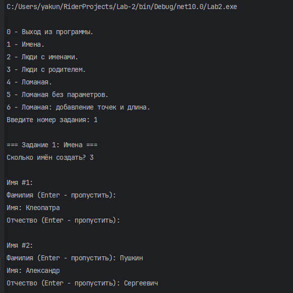
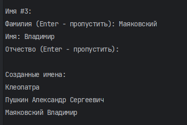
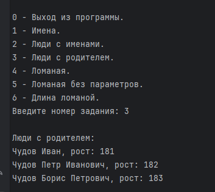
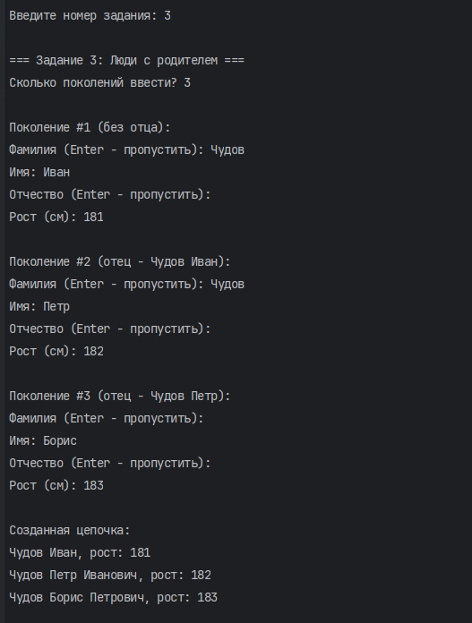
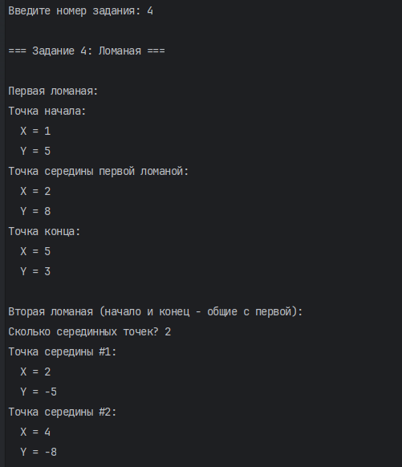
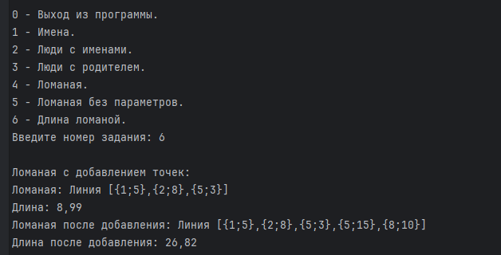

# Лабораторная работа №2

**Студент:** Якунин Андрей  
**Группа:** ИТ-2

---

## Задание 1. Имена

### Задача 3

- **Текст задачи:** Создать класс `Name`, описывающий имя человека с помощью трёх параметров: фамилии, личного имени и отчества. Предусмотреть возможность отсутствия некоторых параметров. При преобразовании объекта в строку незаданные параметры не должны отображаться.
- **Алгоритм решения:** Создан класс `Name`, содержащий поля фамилии, личного имени и отчества, а также свойства для доступа к ним. Реализованы три конструктора, позволяющие создать имя только с личным именем, с фамилией и личным именем либо со всеми тремя параметрами. Метод `ToString()` формирует строковое представление имени. Пользователь вводит количество имён, а затем данные каждого имени с клавиатуры. Фамилию и отчество можно пропустить, нажав Enter. После ввода программа выводит все созданные имена.
- **Тестирование:** Проверен ввод нескольких имён с фамилией и отчеством, только с фамилией и личным именем, а также только с личным именем. Проверено корректное отображение результатов.

---

## Задание 2. Люди с именем

### Задача 2

- **Текст задачи:** Создать класс `People`, объединяющий имя человека и его рост. Имя должно представляться объектом класса `Name`.
- **Алгоритм решения:** Создан класс `People`, содержащий объект `Name` и поле `height`. Реализованы конструкторы и свойства для доступа к имени и росту. Метод `ToString()` возвращает строковое представление имени и роста человека. Пользователь вводит количество людей, после чего для каждого человека указывает данные имени и рост в сантиметрах. Созданные объекты сохраняются в массиве и выводятся на экран.
- **Тестирование:** Проверено создание нескольких людей с разными именами и значениями роста. Проверено корректное отображение введённых данных.

### Задача 3

- **Текст задачи:** Дополнить класс `People` возможностью указывать отца человека, который также является объектом класса `People`. Если у человека отсутствует фамилия, она должна наследоваться от отца. Если отсутствует отчество, оно формируется на основе личного имени отца с добавлением суффикса «ович».
- **Алгоритм решения:** В класс `People` добавлено поле `father`, содержащее ссылку на объект отца. Пользователь вводит количество поколений и данные каждого человека: имя и рост. Первый человек создаётся без отца, а каждый следующий связывается с предыдущим объектом в качестве отца. При вызове `ToString()` проверяется наличие фамилии и отчества. Если они отсутствуют, программа пытается сформировать их на основе данных отца.
- **Тестирование:** Проверено создание цепочки из нескольких поколений. Проверено автоматическое заполнение фамилии и отчества при отсутствии соответствующих данных у человека.

---

## Задание 3. Ломаная

### Задача 2

- **Текст задачи:** Создать классы `Point` и `Polygonal` для представления ломаной линии в виде массива точек. Создать две ломаные, имеющие общие начальную и конечную точки. Изменение координат общей точки должно отражаться в обеих ломаных.
- **Алгоритм решения:** Создан класс `Point`, содержащий координаты X и Y, а также свойства для их изменения. Метод `ToString()` возвращает координаты точки в формате `{X;Y}`. Класс `Polygonal` хранит массив объектов `Point` и формирует строковое представление ломаной. Пользователь вводит координаты начальной, средней и конечной точек первой ломаной. Затем указывает количество дополнительных точек и их координаты для второй ломаной. Обе ломаные используют общие объекты начальной и конечной точек. После вывода исходных ломаных пользователь вводит новые координаты начальной точки, и программа отображает результат изменения.
- **Тестирование:** Проверено создание двух ломаных с общими начальной и конечной точками. После изменения координат общей начальной точки проверено, что изменения отображаются в обеих ломаных.

---

## Задание 4. Ломаная без параметров

### Задача 9

- **Текст задачи:** Дополнить класс `Polygonal` возможностью создавать ломаную без указания параметров, а также создавать ломаную с использованием заданного набора точек.
- **Алгоритм решения:** В классе `Polygonal` реализованы два конструктора. Первый принимает массив точек, второй создаёт пустую ломаную с пустым массивом. Пользователь сначала видит пустую ломаную, созданную без параметров. Затем вводит количество точек и координаты каждой точки. На основе введённых данных создаётся и выводится ломаная.
- **Тестирование:** Проверено создание и отображение пустой ломаной. Также проверено создание ломаной с несколькими точками, координаты которых вводятся с клавиатуры.

---

## Задание 5. Добавление точек и длина ломаной

### Задача 7

- **Текст задачи:** Дополнить класс `Polygonal` методами добавления новых точек или массива точек, а также методом вычисления длины ломаной.
- **Алгоритм решения:** Реализованы методы `Add()` для добавления одной точки и массива точек. При добавлении создаётся новый массив, содержащий исходные и новые точки. Метод `Length()` вычисляет длину ломаной как сумму расстояний между всеми соседними точками по формуле расстояния между двумя точками на плоскости. Пользователь вводит количество исходных точек и их координаты. Программа выводит ломаную и вычисляет её длину. Затем пользователь вводит количество добавляемых точек и их координаты. После добавления программа повторно выводит ломаную и вычисляет новую длину.
- **Тестирование:** Проверено вычисление длины ломаной до добавления точек и после него. Проверено корректное добавление новых точек и изменение общей длины ломаной.

---

## Вывод

В ходе лабораторной работы были разработаны классы `Name`, `People`, `Point` и `Polygonal`. Реализованы конструкторы, свойства, методы строкового представления объектов, работа со ссылками между объектами, добавление точек в массив и вычисление длины ломаной. Для взаимодействия с пользователем организован ввод данных с клавиатуры. Добавлены проверки обязательных строковых значений и допустимых диапазонов целочисленных данных. Работоспособность программы проверена путём выполнения всех заданий и анализа результатов в консоли.
